logseq-entity:: [[Logseq/Entity/YouTube]]
created-by:: [[Person/Lydia Hallie]]
date-created:: [[2026-11-11 Wed]]
logseq-created-time-year:: [[20/2/6]]
runtime:: 00:17:31

- # [Rethinking Claude Code Best Practices — Lydia Hallie, Anthropic](https://www.youtube.com/watch?v=vlfCjWuv4es)
	- [[Person/Lydia Hallie]] of the [[Claude/Code]] team at [[Anthropic]] gave this talk on the main stage of [[AI/ES/26/11 Code]] on [[2026-11-11 Wed]]. Technical difficulties interrupted the live talk, so she recorded it again at home that day. The AI Engineer channel published the recording.
	- Lydia starts from a Claude Code session of early 2026 (Opus 4.5, manual approvals, a CLAUDE.md full of "IMPORTANT") and shows, for each step a person used to do, whether the model, the harness, or the environment now does it.
	- ## Key takeaways
		- Start from today's defaults: [[Anthropic/Model/Claude/5/5/Opus]] and auto mode, which became the default permission mode in August 2026. [2:46](https://www.youtube.com/watch?v=vlfCjWuv4es&t=166s)
		- Cut CLAUDE.md down to what Claude can't see from the code. "IMPORTANT" and "never do this!" lines now push the model off track, which means more tool calls and worse results. `/doctor prompt-audit` checks CLAUDE.md and skills for what the current model no longer needs. [3:19](https://www.youtube.com/watch?v=vlfCjWuv4es&t=199s)
		- When auto mode still blocks routine work, describe your trusted repos, buckets and domains in plain English in the `autoMode` block of your settings. The classifier reads that text. [4:48](https://www.youtube.com/watch?v=vlfCjWuv4es&t=288s)
		- Auto mode blocked 89% of dangerous commands in Anthropic's August study, against 14% caught by people, so about one in ten still went through. Deny rules are the guarantee: Claude Code checks them before the classifier, which never sees a matching call. [5:46](https://www.youtube.com/watch?v=vlfCjWuv4es&t=346s)
		- Decide what needs a rule by asking "if Claude gets this wrong once, can I take it back?" Wrong code can be reverted, so leave it to the model. Losing uncommitted changes or exposing a secret can't be taken back, so write a rule. [6:32](https://www.youtube.com/watch?v=vlfCjWuv4es&t=392s)
		- Permissions decide whether a tool call runs. A sandbox limits what the command and its child processes can read, write and reach, and the operating system enforces it, so a compromised dependency inside `npm test` can't open `.env`. The sandbox covers shell commands only; Read, Edit, WebFetch, MCP servers and hooks run outside it. [7:56](https://www.youtube.com/watch?v=vlfCjWuv4es&t=476s)
		- Run long sessions in a cloud session ([[Claude/Code/Cloud Session]]). Each one gets its own machine with a fresh copy of the repo and keeps running with the laptop closed. `.env`, SSH keys and the GitHub token aren't there, API keys go in as network secrets, and network access is limited by default. Keep auto mode on and commit deny rules to the repo, because pushed commits and sent messages outlive the disposable machine. [9:10](https://www.youtube.com/watch?v=vlfCjWuv4es&t=550s)
		- Set up verification points that pass or fail along the way: tests, a build, a screenshot. In the prompt, say what done looks like, ask for tasks that each have a test, and ask to see the test output. [10:54](https://www.youtube.com/watch?v=vlfCjWuv4es&t=654s)
		- Use hooks for checks that must run: lint after every edit (`PostToolUse`), the changed area's tests when a task completes (`TaskCompleted`), the whole suite at the end (`Stop`). Exit with code 2 to send Claude back to fix it; with exit code 1 the task is marked completed anyway. [12:07](https://www.youtube.com/watch?v=vlfCjWuv4es&t=727s)
		- Once many sessions run, CI matters most, because it runs the same checks on every PR. CI auto-fix lets Claude fix failing checks, and merge when ready lets GitHub merge low-risk PRs once checks pass. [14:00](https://www.youtube.com/watch?v=vlfCjWuv4es&t=840s)
		- Tier human review by risk. On her team Claude reviews every PR first, from a fresh context with a separate group of agents to double-check each bug, and then: "smaller changes like docs or copy, they don't need a person ... ordinary product changes just need one reviewer and then risky changes might need two." [14:39](https://www.youtube.com/watch?v=vlfCjWuv4es&t=879s)
		- Hand session starts to an orchestrator. Claude Code projects (beta) take one request, split it into threads that are new sessions, verify what comes back, and manage context automatically. Use a model that decides and judges, like Fable, for the main session, and one that does the work, like Opus 5.5, for the threads. [15:10](https://www.youtube.com/watch?v=vlfCjWuv4es&t=910s)
		- To try it, give Claude a task much bigger than usual, make sure CI catches what you care about, configure the cloud environment's network access, secrets and setup script, then start in the cloud and see where sessions get stuck. [17:02](https://www.youtube.com/watch?v=vlfCjWuv4es&t=1022s)
	- ## [[Readwise]] highlights
		- From [Reader](https://read.readwise.io/read/01m817wsct0eq9j8a4a0hxak41), quoted as Readwise stored them.
		- [1:19](https://www.youtube.com/watch?v=vlfCjWuv4es&t=79s)
			- > So nowadays, at least at Anthropic, our sessions look more like this. So we're running dozens of sessions at the same time, running for hours, verifying their own results along the way, and we even have sessions orchestrate other sessions.
			  >
			  > So whereas we used to be in the loop for almost every step and running one or just a couple sessions at a time, we've now essentially become managers for dozens of sessions. We also get a lot more done, though. Now, you may have seen our blog post in October about how Anthropic went from about 2500 changes a day in May to more than 30,000 a day in September. But this also means that we as developers just have to rethink on what we're focused on instead.
		- [3:37](https://www.youtube.com/watch?v=vlfCjWuv4es&t=217s)
			- > So nowadays your CLAUDE.md file should only include the things that Claude cannot see from your code.
			  >
			  > So for example, maybe you have a service that's still using some legacy source somewhere, but it's not directly referenced in the code. That's still good to keep in there. But everything else like what stack you're on or where to look, you really don't need that anymore.
			  >
			  > And we actually have a command for this called doctor prompt audit, which makes it really easy to optimize your environment for a specific model. So if you're on Opus 55 here and you run this command, it will automatically check your CLAUDE.md and your skills to see what the new model no longer needs.
		- [4:48](https://www.youtube.com/watch?v=vlfCjWuv4es&t=288s)
			- > Now the defaults should be good in most cases. But if you still notice that you have to approve a lot of commands even in auto mode, the first thing to look at is settings here because you can configure auto mode in your own settings just in plain English. And this is what gets sent to the classifier, which then decides whether to reject or allow certain commands.
			- [[My Notes]]: Crazy syntax here
		- [6:01](https://www.youtube.com/watch?v=vlfCjWuv4es&t=361s)
			- > But about one in 10 of those commands still went through. So if you do want the guarantee, you can only enforce that in the harness. And this is where some of our older best practices still matters and that's permissions.
			  >
			  > So for example, if you have a deny rule for a specific tool call in your project, cloud Code looks at this rule before the auto mode classifier even looks at it. In fact, if a tool call matches a deny rule, the classifier never even sees it.
			  >
			  > So having deny rules is still the best way to make sure clot actually never does something. But then how do you know what needs to be a rule in your project versus what the model can just know because they've gotten so good at it?
			  >
			  > I think it kind of just comes down to if clot gets as wrong once, can I take it back? So if it writes the wrong code, you can still revert that. So you can still leave that to the model, but if it throws away or uncommitted changes or it reads a key that's now in your transcript and you don't want that, that should still be a rule.
		- [7:56](https://www.youtube.com/watch?v=vlfCjWuv4es&t=476s)
			- > And permissions only decide if a tool call runs, but they cannot limit what it can reach once it's running.
			  >
			  > So we want to make sure that these kinds of scripts can still run because this is just part of you know how cloud can check its own work running tests. So we cannot just block npm tests but we want to limit its side effects. So really we just want to limit the environment that it's running in. So if you're running it locally or on your own machine, you can run commands like that in a sandbox.
			  >
			  > So then you have control over which files in a command it can read, which folders it can write to, which hosts it can reach, and the operating system enforces that. Also, this also applies to everything that command then starts, so any child processes.
		- [8:53](https://www.youtube.com/watch?v=vlfCjWuv4es&t=533s)
			- > So now when that dependency tries to open our end file, the operating system just doesn't let it. And by default, it can still read most of your machine. So you'd want to add another rule for your SSH keys if you care about that.
		- [11:58](https://www.youtube.com/watch?v=vlfCjWuv4es&t=718s)
			- > So that's pretty reasonable. So, if one of these runs would still log everyone out, it doesn't get past that first check and then it just has to find another way. And there's a couple ways to set this up. The easiest one is, of course, just in your prompt. So, you know, you say what done looks like and ask it to split that into tasks so they have their own tests.
			  >
			  > And I also like to ask it to show the actual output because you weren't there to see it.
		- [12:47](https://www.youtube.com/watch?v=vlfCjWuv4es&t=767s)
			- > So you know if it touched our off code or something, it has to pass the off tests. And when it wants to finish the whole session, we can just run the entire test suite, and if one of those fails, it goes, "Oh, that's still broken." It goes back until it passes so it fixes it.
			  >
			  > Now just one thing, when a test fails by default, most tools they exit with a one exit code, but with a one, that task by clock Code just gets marked as completed anyway. So, make sure that your scripts exit with a twoexit code because that's what actually sends Cloud back to fix it.
		- [14:53](https://www.youtube.com/watch?v=vlfCjWuv4es&t=893s)
			- > And then how much we review ourselves just depends on the risk. So smaller changes like docer copy, they don't need a person. So once the automated checks are green, we're pretty good to go. Maybe ordinary product changes just need one reviewer and then risky changes might need two.
		- [15:31](https://www.youtube.com/watch?v=vlfCjWuv4es&t=931s)
			- > And you can already see this in things like cloud Code projects, which is still in beta, but you just tell it what it needs to be done and the orchestrator splits that up and then starts other sessions for each task and it keeps track of what comes back. So it automatically starts and verifies these threads, which are just new sessions.
			  >
			  > So instead of talking to eight sessions, you're just talking to one. And the main session doesn't write the code itself.
			  >
			  > So there you want a model that's really good at deciding what to do and judging what comes back. A model like Fable, and if something comes back that isn't actually done, it just, you know, sends it back. So until it's actually done and passes everything.
	- ## [[Video]]
		- {{video https://www.youtube.com/watch?v=vlfCjWuv4es}}
			- ### {{youtube-timestamp 0}} Evolution of workflow
				- {{youtube-timestamp 0}} **Slide 01**
					- 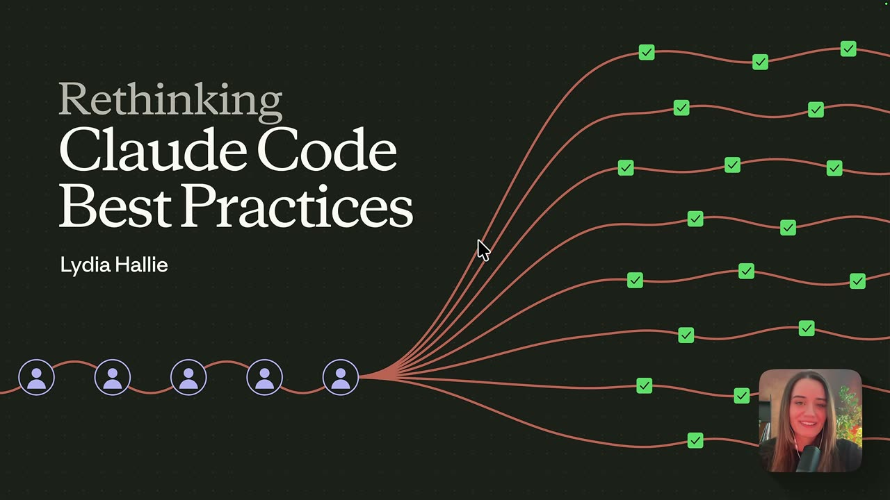
					- Rethinking Claude Code Best Practices. Lydia Hallie. A row of person icons, then one line fanning out into many lines of green checkmarks.
				- {{youtube-timestamp 0}} I had some technical difficulties during my talk this morning, so I ran back home and I'm just going to record it from my computer instead. So, hi everyone. I'm Lydia. I work on the Claude Code team at Anthropic.
				- {{youtube-timestamp 11}} **Slide 02**
					- 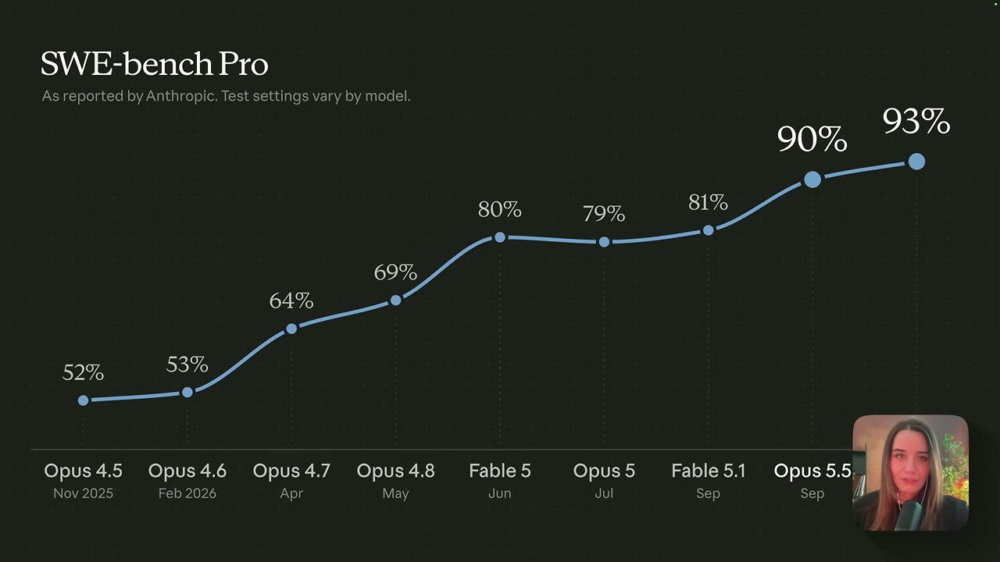
					- SWE-bench Pro, as reported by Anthropic; test settings vary by model. Opus 4.5 (Nov 2025) 52%, Opus 4.6 (Feb 2026) 53%, Opus 4.7 (Apr) 64%, Opus 4.8 (May) 69%, Fable 5 (Jun) 80%, Opus 5 (Jul) 79%, Fable 5.1 (Sep) 81%, Opus 5.5 (Sep) 90%, then 93%.
				- {{youtube-timestamp 11}} And the models have gotten really good lately. So we have [[Anthropic/Model/Claude/5/5/Opus]], which is my favorite daily driver. And earlier this week, we also launched [[Anthropic/Model/Claude/5/2/Fable]]. And these models are extremely good at long-running tasks and understanding your codebase. And especially Fable is also really good at verifying its own output.
				- {{youtube-timestamp 31}} But as these models get better, the way that we work with them in Claude Code also changes. So earlier this year, I don't know if you remember, but sessions kind of used to look like this. So we'd use a model like [[Anthropic/Model/Claude/4.5/Opus]], which honestly for its time was really good. I really enjoyed working with Opus 4.5. But compared to today, it would just stop a lot earlier. So it would just run for shorter amounts of time.
				- {{youtube-timestamp 53}} **Slide 03**
					- 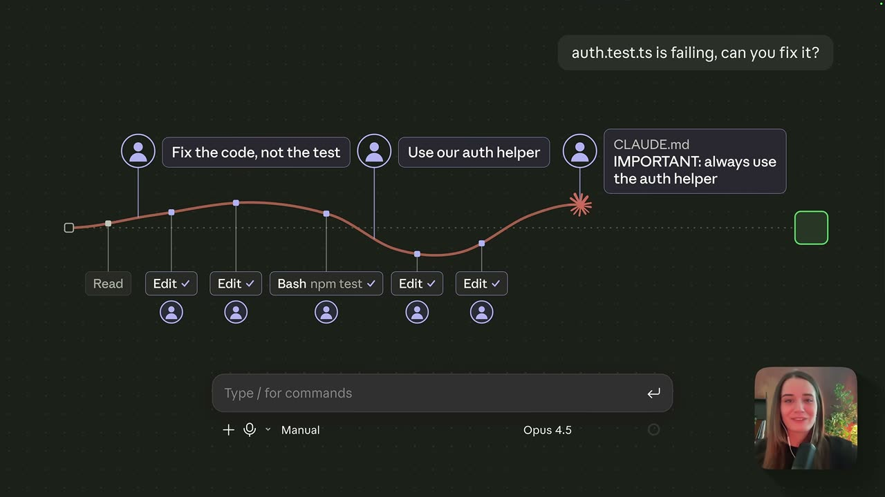
					- A session timeline for "auth.test.ts is failing, can you fix it?" on Opus 4.5 in Manual mode: Read, Edit, Edit, Bash npm test, Edit, Edit. The person steps in with "Fix the code, not the test", "Use our auth helper", and a CLAUDE.md line "IMPORTANT: always use the auth helper".
				- {{youtube-timestamp 53}} And we'd also keep correcting it. We'd keep reminding it to do things, add things like "IMPORTANT", exclamation mark, all these things to our [[Claude/Code/Claude.md]] file.
				- {{youtube-timestamp 60}} **Slide 04**
					- 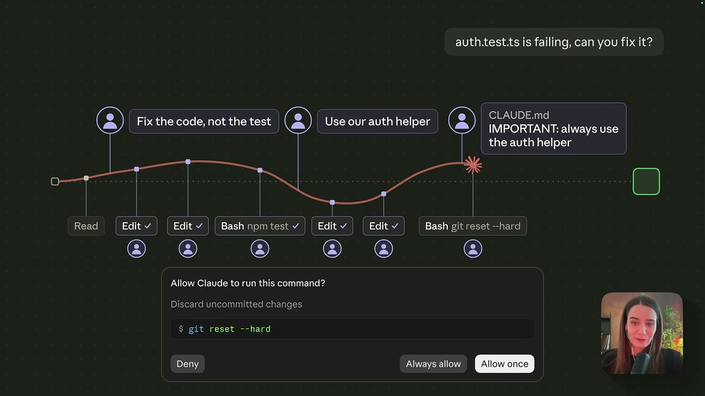
					- The same timeline with a permission prompt: "Allow Claude to run this command? Discard uncommitted changes: `git reset --hard`", with Deny, Always allow, and Allow once.
				- {{youtube-timestamp 60}} And also features like auto mode didn't exist yet. So we were either approving everything manually or taking the riskier approach with `--dangerously-skip-permissions`. So we were still very much in the loop as humans.
				- {{youtube-timestamp 74}} **Slide 05**
					- 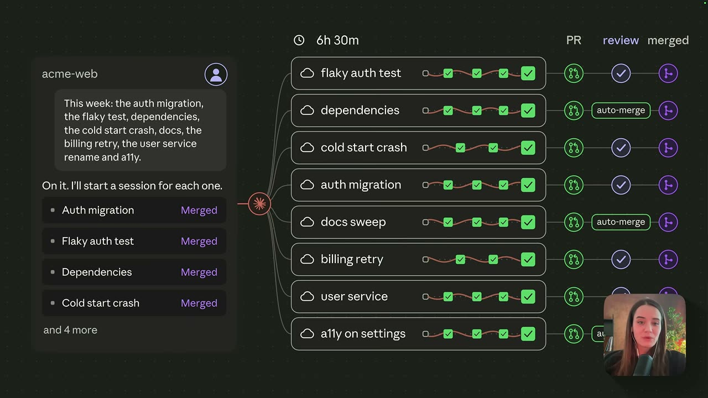
					- acme-web. "This week: the auth migration, the flaky test, dependencies, the cold start crash, docs, the billing retry, the user service rename and a11y." "On it. I'll start a session for each one." Eight cloud sessions (flaky auth test, dependencies, cold start crash, auth migration, docs sweep, billing retry, user service, a11y on settings) run for 6h 30m, each with columns PR, review, merged; dependencies and docs sweep show auto-merge.
				- {{youtube-timestamp 75}} But as these models got better at taking on bigger tasks, our sessions also changed. So nowadays, at least at Anthropic, our sessions look more like this. So we're running dozens of sessions at the same time, running for hours, verifying their own results along the way, and we even have sessions orchestrate other sessions. So whereas we used to be in the loop for almost every step and running one or just a couple sessions at a time, we've now essentially become managers for dozens of sessions.
				- {{youtube-timestamp 103}} **Slide 06**
					- 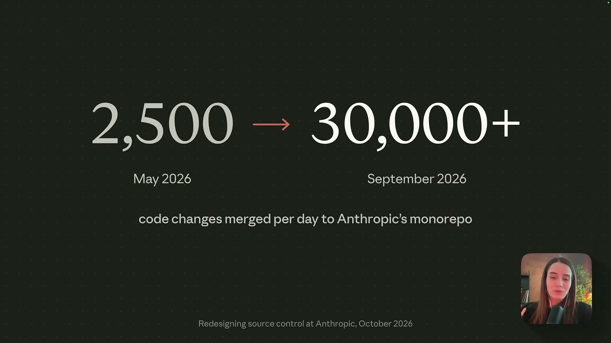
					- 2,500 (May 2026) → 30,000+ (September 2026) code changes merged per day to Anthropic's monorepo. Source: Redesigning source control at Anthropic, October 2026.
				- {{youtube-timestamp 103}} We also got a lot more done, though. Now you may have seen our blog post in October about how Anthropic went from about 2,500 changes a day in May to more than 30,000 a day in September. But this also means that we as developers just have to rethink what we're focused on instead.
				- {{youtube-timestamp 119}} **Slide 07**
					- 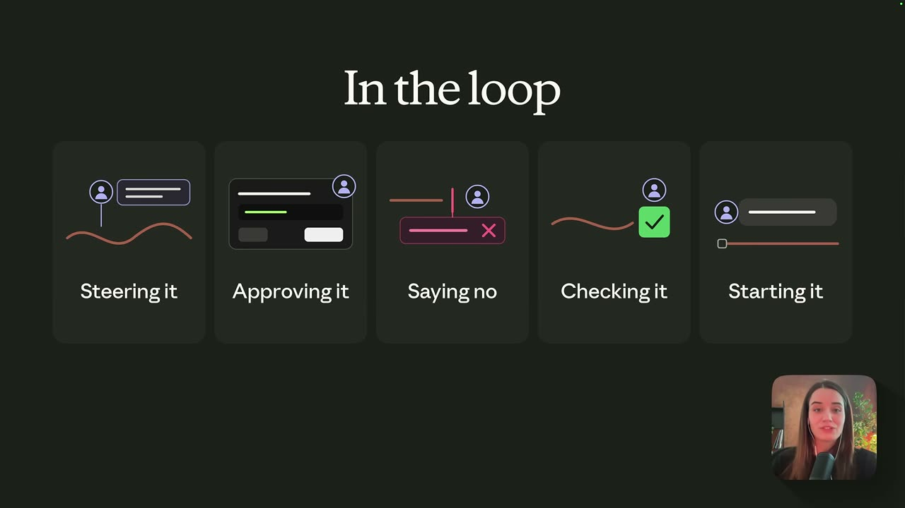
					- In the loop: Steering it, Approving it, Saying no, Checking it, Starting it.
				- {{youtube-timestamp 120}} So, if you think about our best practices from earlier this year, it was mainly about steering sessions, approving commands, saying no to certain things or restricting what Claude could do, [checking] the output, and also starting the sessions.
			- ### {{youtube-timestamp 134}} Rethinking best practices
				- {{youtube-timestamp 133}} **Slide 08**
					- 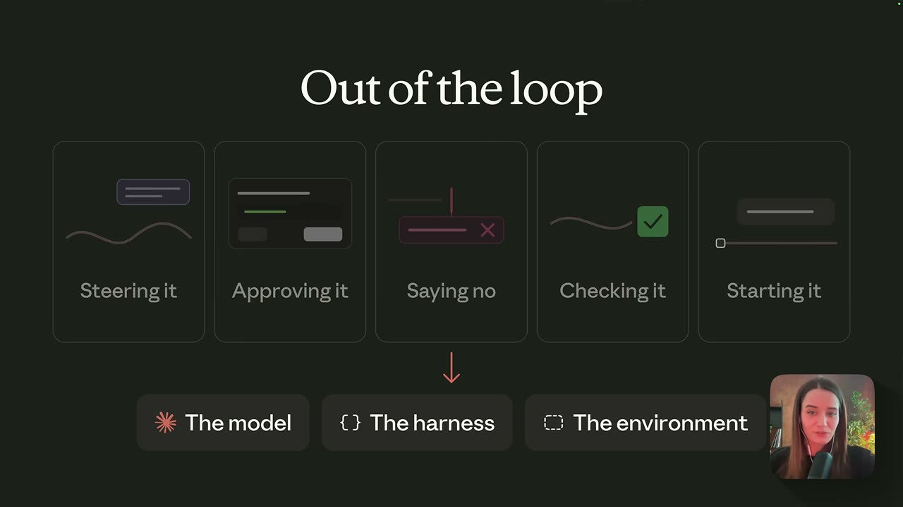
					- Out of the loop: Steering it, Approving it, Saying no, Checking it, Starting it, each handed to The model, The harness, or The environment.
				- {{youtube-timestamp 134}} So, everywhere that we now step out of that loop, something else has to take over. And this is either the model, the harness, or the environment that it's running in.
				- {{youtube-timestamp 143}} **Slide 09**
					- 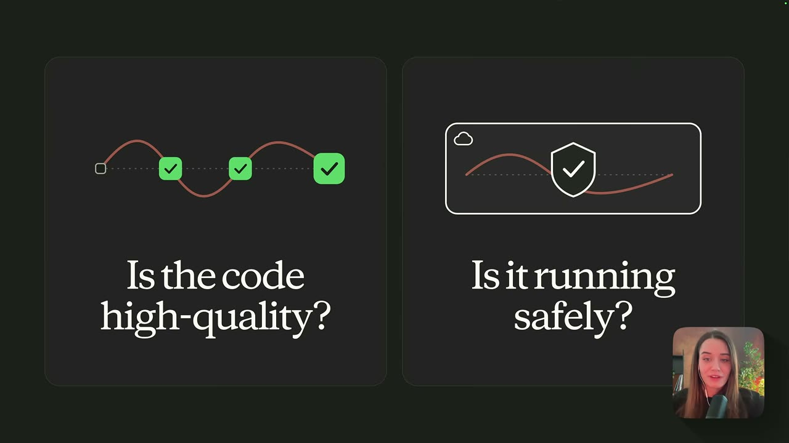
					- Is the code high-quality? Is it running safely?
				- {{youtube-timestamp 144}} So, if we are not in the loop to approve every command and we're running so many sessions at the same time, how can we make sure that the code it's writing is still high quality? And most importantly, if these sessions are running for hours without our supervision, how can we make sure that they're running safely? So, let's go through that by taking this old session and seeing what we have to change to get to that end result that I showed earlier.
				- {{youtube-timestamp 175}} **Slide 10**
					- 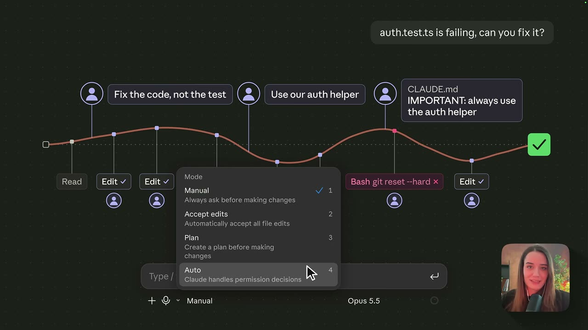
					- The old session with the model picker (Fable 5.2, Opus 5.5, Sonnet 5.5, Haiku 5.5) and the mode picker: Manual (always ask before making changes), Accept edits (automatically accept all file edits), Plan (create a plan before making changes), Auto (Claude handles permission decisions).
				- {{youtube-timestamp 166}} Well, first of all, let's use the actual defaults we start sessions in nowadays. So, that's not really something you should think about. So, let's update the model here from Opus 4.5 to Opus 5.5 and change the manual permission to auto mode.
				- {{youtube-timestamp 177}} **Slide 11**
					- 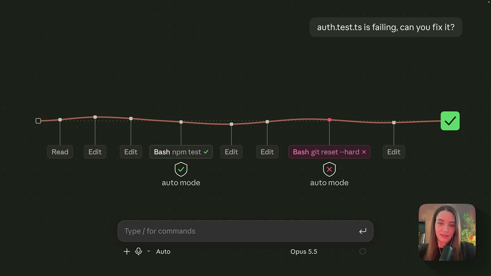
					- The same task on Opus 5.5 in Auto mode: no steering notes, auto mode allows `npm test` and blocks `git reset --hard`, and the session ends green.
				- {{youtube-timestamp 177}} And Opus 5.5 is a lot better at understanding your intent and understanding your codebase. So, we really don't have to steer it as much anymore mid-session. And you also no longer have to approve every command because we started making auto mode the default permission mode back in August.
				- {{youtube-timestamp 192}} **Slide 12**
					- 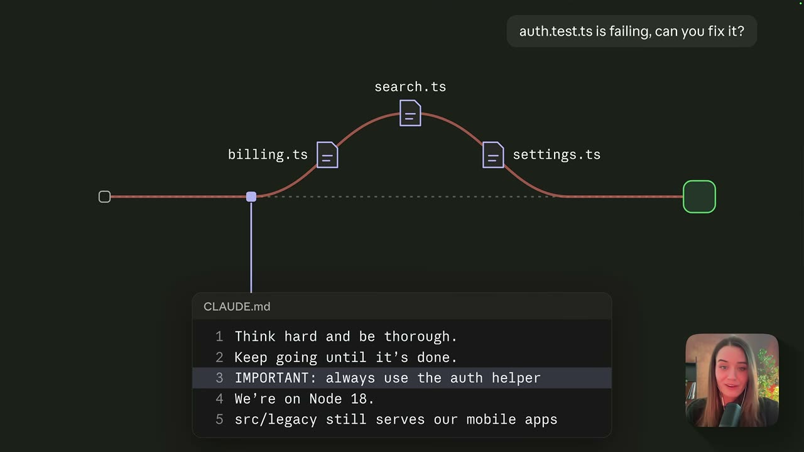
					- CLAUDE.md: "1 Think hard and be thorough. 2 Keep going until it's done. 3 IMPORTANT: always use the auth helper 4 We're on Node 18. 5 src/legacy still serves our mobile apps", over a session that edits billing.ts, search.ts and settings.ts.
				- {{youtube-timestamp 192}} Now, being better at understanding your intent and your codebase also means that we have to rethink the instructions we have in our codebase. So, if you followed our best practices from earlier this year, you may still have things like "IMPORTANT" or "never do this", exclamation mark, all these things in your CLAUDE.md file. But with today's models, you really don't need that and it can actually make the model go off track. So, you end up with more tool calls and overall a worse result.
				- {{youtube-timestamp 216}} **Slide 13**
					- 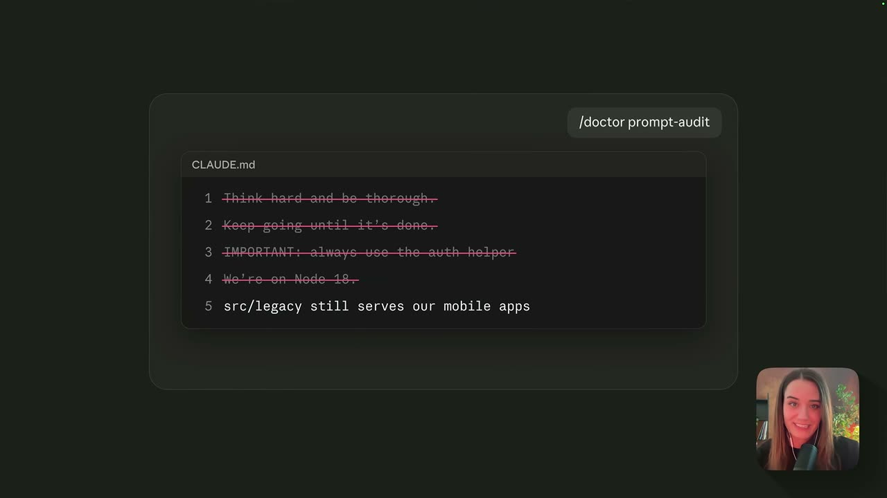
					- `/doctor prompt-audit` strikes lines 1 to 4 of CLAUDE.md and keeps "src/legacy still serves our mobile apps".
				- {{youtube-timestamp 217}} So, nowadays your CLAUDE.md file should only include the things that Claude cannot see from your code. So, for example, maybe you have a service that's still using some legacy source somewhere, but it's not directly referenced in the code. That's still good to keep in there. But everything else, like what stack you're on or where to look, you really don't need that anymore.
				- {{youtube-timestamp 234}} And we actually have a command for this called `/doctor prompt-audit`, which makes it really easy to optimize your environment for a specific model. So, if you're on Opus 5.5 here and you run this command, it will automatically check your CLAUDE.md and your [[Claude/Code/Skill]]s to see what the new model no longer needs.
			- ### {{youtube-timestamp 251}} Managing auto mode
				- {{youtube-timestamp 251}} **Slide 14**
					- 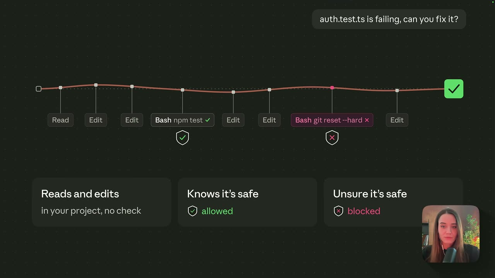
					- Reads and edits: in your project, no check. Knows it's safe: allowed. Unsure it's safe: blocked.
				- {{youtube-timestamp 251}} Now, auto mode is a permission mode that runs a separate classifier on pretty much everything that isn't just reading or editing files in your project. So, it automatically allows commands that it knows are safe, like running tests or installing dependencies, but it still blocks commands where it's unsure whether they're safe.
				- {{youtube-timestamp 269}} **Slide 15**
					- 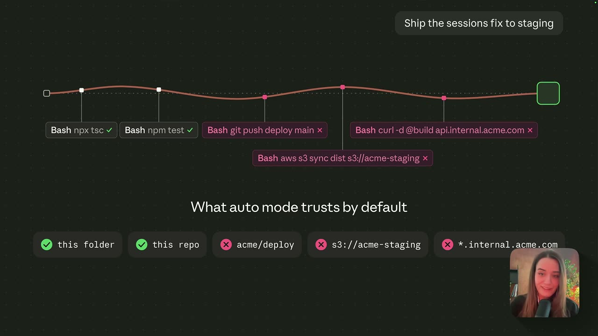
					- "Ship the sessions fix to staging": Bash npx tsc and Bash npm test are allowed; `git push deploy main`, `curl -d @build api.internal.acme.com` and `aws s3 sync dist s3://acme-staging` are blocked. What auto mode trusts by default: this folder, this repo; not acme/deploy, s3://acme-staging, or *.internal.acme.com.
				- {{youtube-timestamp 269}} And normally that's pretty good. Normally that's kind of, you know, what we want. But for example here, if we ask it to ship something to staging, we would have just, you know, approved the push to our deploy repo. But by default, auto mode only trusts this folder and this repo, so it would block that command. So, we're back in the loop.
				- {{youtube-timestamp 288}} **Slide 16**
					- 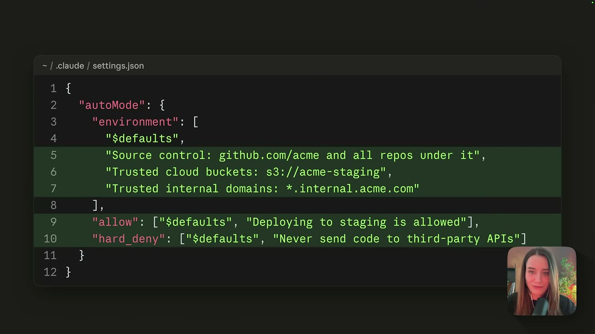
					- `~/.claude/settings.json`:
						- ~~~json
						  {
						    "autoMode": {
						      "environment": [
						        "$defaults",
						        "Source control: github.com/acme and all repos under it",
						        "Trusted cloud buckets: s3://acme-staging",
						        "Trusted internal domains: *.internal.acme.com"
						      ],
						      "allow": ["$defaults", "Deploying to staging is allowed"],
						      "hard_deny": ["$defaults", "Never send code to third-party APIs"]
						    }
						  }
						  ~~~
				- {{youtube-timestamp 288}} Now, the defaults should be good in most cases, but if you still notice that you have to approve a lot of commands even in auto mode, the first thing to look at is settings here, because you can configure auto mode in your own settings just in plain English, and this is what gets sent to the classifier, which then decides whether to reject or allow certain commands. So, here we can just write which repos, buckets, domains we trust and what it should always allow or never do.
				- {{youtube-timestamp 313}} Okay, so honestly this was pretty easy by just using today's defaults. We've already gotten rid of most of our in-the-loop stuff, because the model took over the steering and auto mode took over all the approving, so getting out of the loop is easy. But the harder question now is how do we make sure it's okay that we're not there anymore? So, first is keeping it safe and then also verification.
			- ### {{youtube-timestamp 330}} Safety and environment
				- {{youtube-timestamp 334}} So, let's start with keeping it safe, because everything so far, so upgrading the model and using auto mode, is just working with a model. And in most cases it does what you tell it to do, but that's not a guarantee.
				- {{youtube-timestamp 346}} **Slide 17**
					- 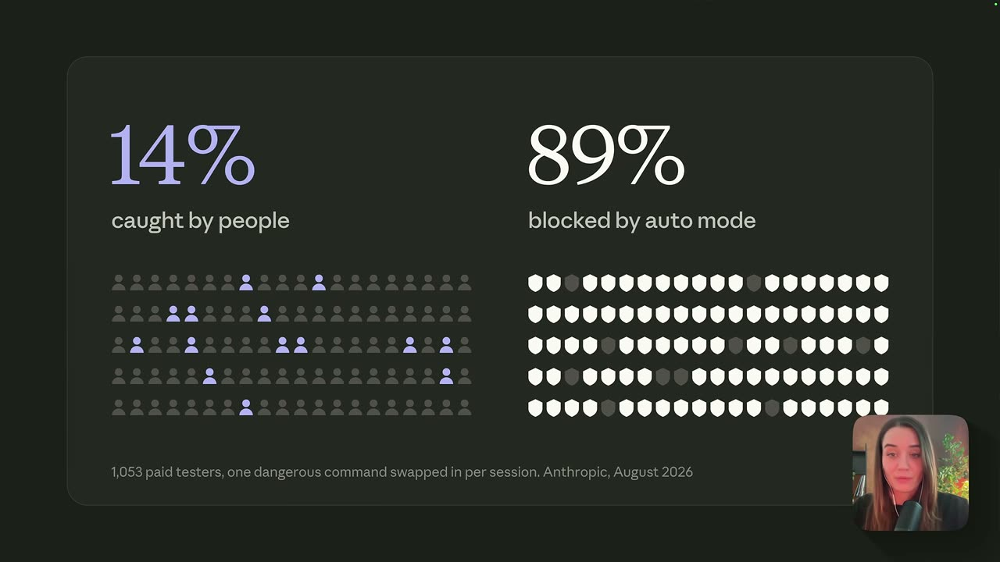
					- 14% caught by people; 89% blocked by auto mode. 1,053 paid testers, one dangerous command swapped in per session. Anthropic, August 2026.
				- {{youtube-timestamp 346}} So, in a study we published back in August, we tested auto mode versus real people in the loop, and only about 14% of people caught a clearly dangerous command. Auto mode blocked 89% of them, so it is a lot better at it than we were.
				- {{youtube-timestamp 361}} **Slide 18**
					- 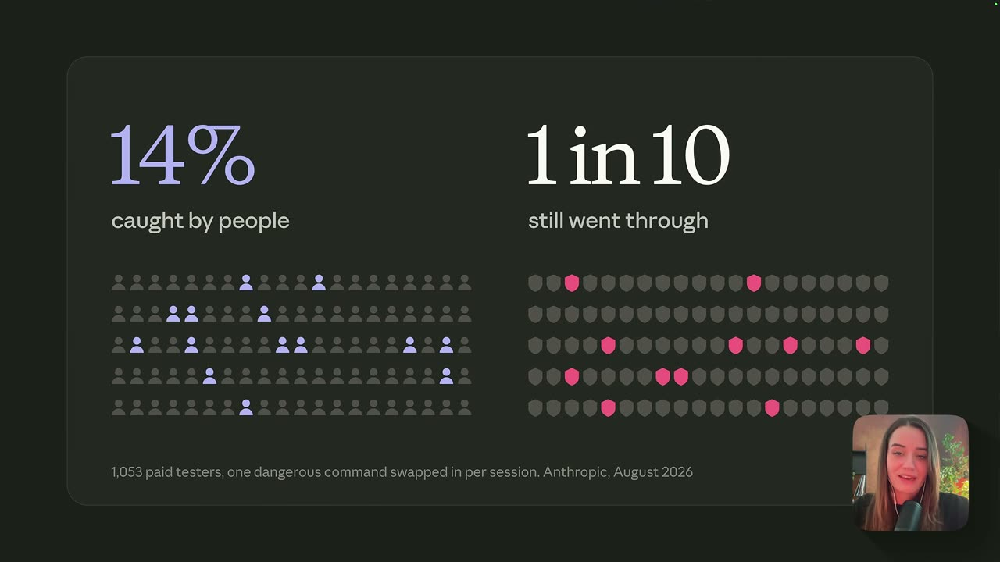
					- 14% caught by people; 1 in 10 still went through.
				- {{youtube-timestamp 361}} But about one in 10 of those commands still went through. So, if you do want the guarantee, you can only enforce that in the harness. And this is where some of our older best practices still matter, and that's permissions.
				- {{youtube-timestamp 364}} **Slide 19**
					- 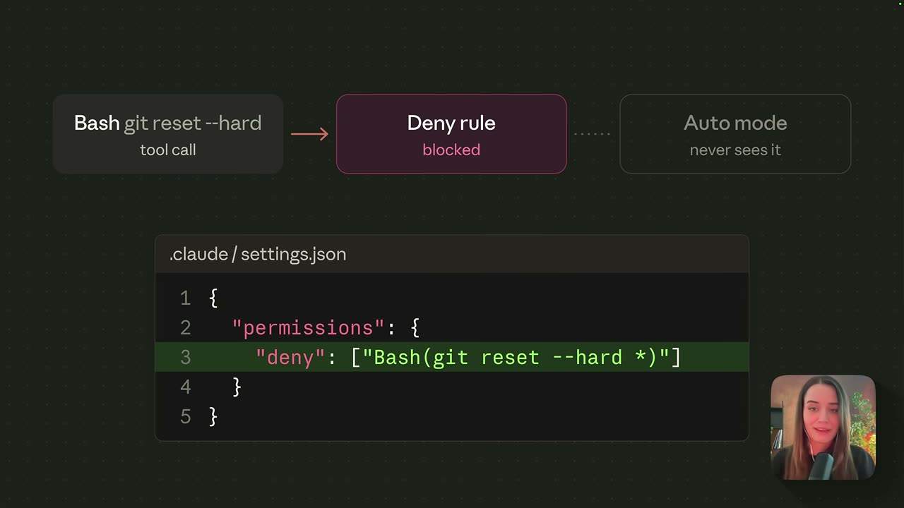
					- Tool call `Bash git reset --hard` → Deny rule: blocked → Auto mode: never sees it. `.claude/settings.json`: `{"permissions": {"deny": ["Bash(git reset --hard *)"]}}`
				- {{youtube-timestamp 371}} So, for example, if you have a deny rule for a specific tool call in your project, Claude Code looks at this rule before the auto mode classifier even looks at it. In fact, if a tool call matches a deny rule, the classifier never even sees it. So, having deny rules is still the best way to make sure Claude actually never does something.
				- {{youtube-timestamp 392}} **Slide 20**
					- 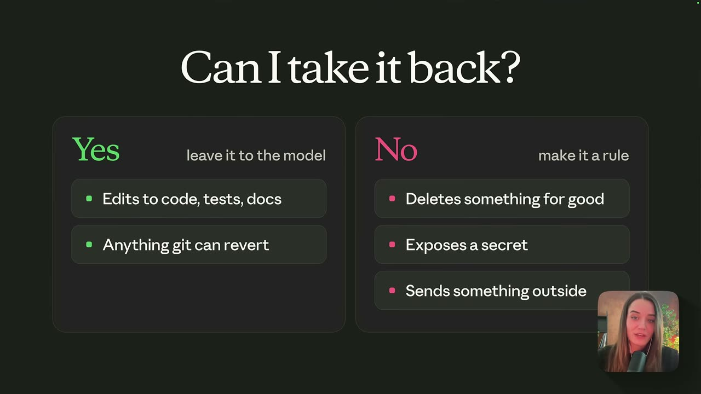
					- Can I take it back? Yes, leave it to the model: edits to code, tests, docs; anything git can revert. No, make it a rule: deletes something for good; exposes a secret; sends something outside.
				- {{youtube-timestamp 392}} But then how do you know what needs to be a rule in your project versus what the model can just know because they've gotten so good at it? I think it kind of just comes down to: if Claude gets this wrong once, can I take it back? So, if it writes the wrong code, you can still revert that. So, you can still leave that to the model. But if it throws away our uncommitted changes or it reads a key that's now in your transcript and you don't want that, that should still be a rule.
				- {{youtube-timestamp 417}} **Slide 21**
					- 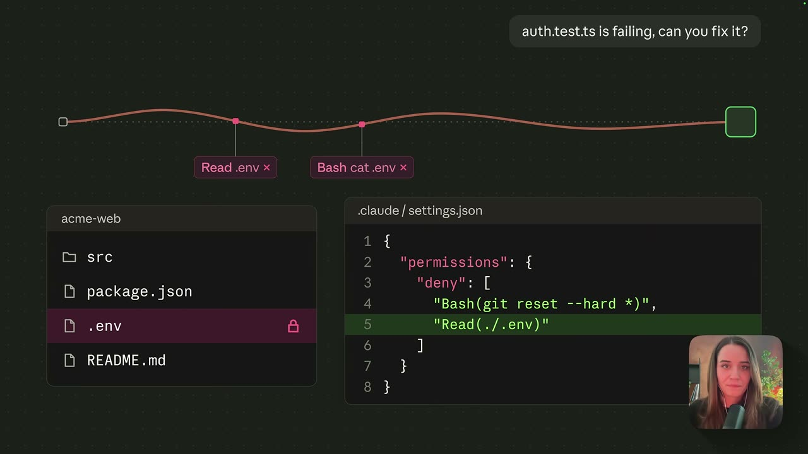
					- The session tries `Read .env` and `Bash cat .env`, both blocked. acme-web contains src, package.json, .env (locked), README.md. `.claude/settings.json` deny list: `"Bash(git reset --hard *)"`, `"Read(./.env)"`.
				- {{youtube-timestamp 417}} So, for example, let's say that we just never want Claude reading our `.env` file. Now, by default, auto mode is fine with this, so it would have just approved it. So, if you want to make sure that Claude can never read this file, you should just add a deny rule. And then commands like `cat` cannot open this file either.
				- {{youtube-timestamp 434}} But it's not always that straightforward, because sometimes certain commands can have side effects. So, for example, let's say that `npm test` here, a very normal command, it's just a test, so auto mode runs it, that's fine.
				- {{youtube-timestamp 445}} **Slide 22**
					- 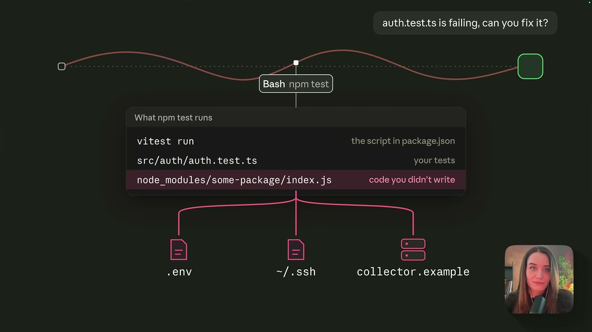
					- What `npm test` runs: `vitest run` (the script in package.json), `src/auth/auth.test.ts`, `node_modules/some-package/index.js` (code you didn't write), which reaches `.env`, `~/.ssh`, and collector.example.
				- {{youtube-timestamp 445}} But when the script is running, it runs code that you didn't write, like your dependencies. Or maybe Claude runs a script real quick that it wrote just to quickly check something. So, if one of those scripts is compromised, it could just open that same `.env` file or your SSH keys and send those to a server you've never heard of, right? And even if we were still there as humans approving everything, honestly, we would have just clicked allow, because there's nothing to say no to. It's just part of the script that, in this example case, `npm test` runs.
				- {{youtube-timestamp 476}} And permissions only decide if a tool call runs, but they cannot limit what it can reach once it's running. So, we want to make sure that these kinds of scripts can still run, because this is just part of, you know, how Claude can check its own work, running tests. So we cannot just block `npm test`, but we want to limit its side effects. So really, we just want to limit the environment that it's running in.
			- ### {{youtube-timestamp 496}} Cloud-based environments
				- {{youtube-timestamp 497}} **Slide 23**
					- 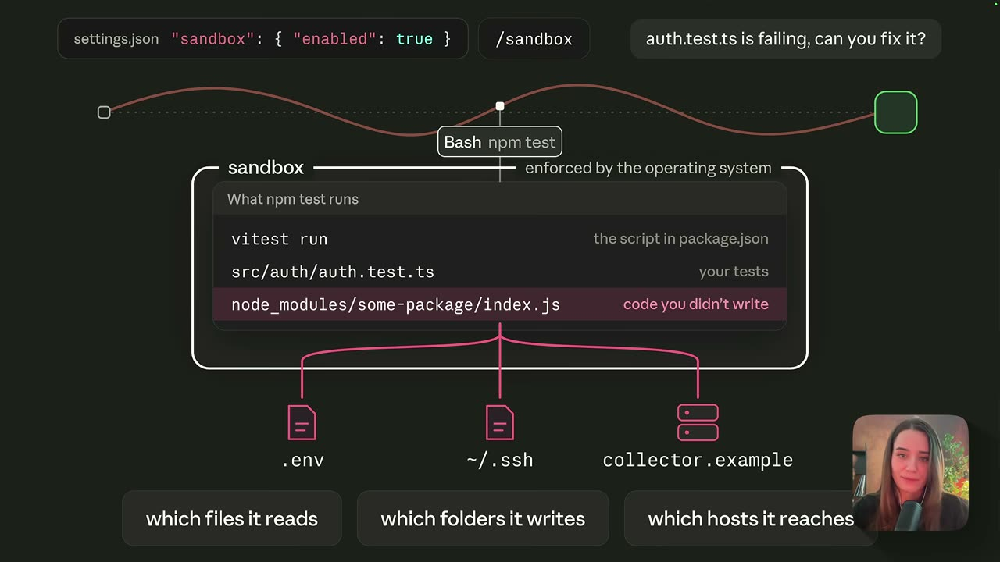
					- `/sandbox`: the same `npm test` run inside a sandbox box labeled "enforced by the operating system", with three controls: which files it reads, which folders it writes, which hosts it reaches.
				- {{youtube-timestamp 498}} So if you're running it locally or on your own machine, you can run commands like that in a sandbox. So then you have control over which files a command can read, which folders it can write to, which hosts it can reach. And the operating system enforces that. Also, this also applies to everything that command then starts, so any child processes.
				- {{youtube-timestamp 518}} **Slide 24**
					- 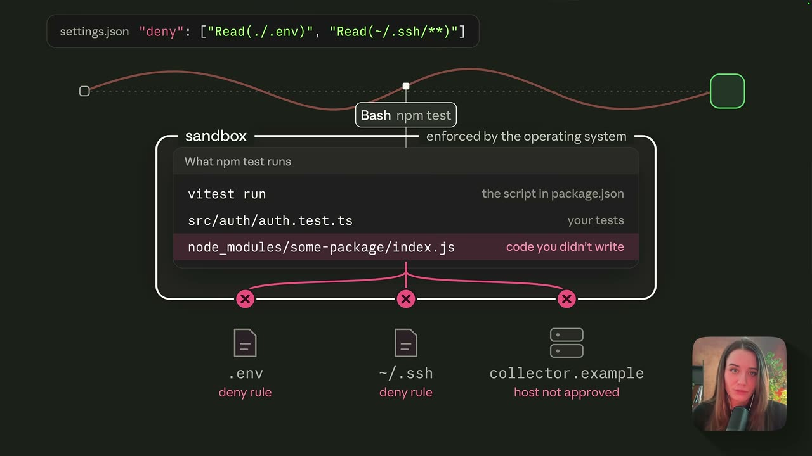
					- With the sandbox on and a deny rule for `Read(~/.ssh/**)`: `.env` blocked (deny rule), `~/.ssh` blocked (deny rule), collector.example blocked (host not approved).
				- {{youtube-timestamp 519}} So on its own, that deny rule gets checked by Claude before the command runs, but all it sees there is `npm test`. So it doesn't see which files that script ends up opening. But with the sandbox on, that same rule gets passed on to the operating system. So now when that dependency tries to open our `.env` file, the operating system just doesn't let it. And by default, it can still read most of your machine, so you'd want to add another rule for your SSH keys if you care about that. And it also cannot reach a host that wasn't approved.
				- {{youtube-timestamp 550}} **Slide 25**
					- 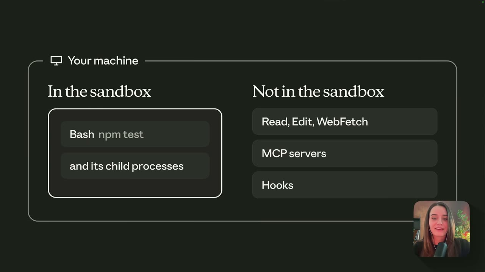
					- Your machine. In the sandbox: Bash npm test, and its child processes. Not in the sandbox: Read, Edit, WebFetch; MCP servers; Hooks.
				- {{youtube-timestamp 550}} But the sandbox only covers the shell commands that Claude runs and whatever those start. But Claude's own file tools, your MCP servers, and all of your hooks still run outside of it. So the rest of your session still runs on your own machine and everything that's on there. So ideally, you want this whole thing to run somewhere where none of that is even there in the first place.
				- {{youtube-timestamp 570}} **Slide 26**
					- 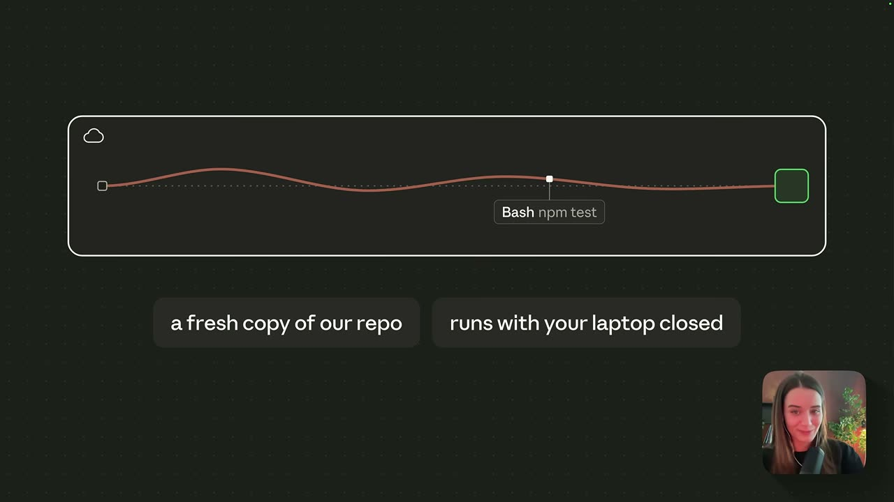
					- A session inside a cloud box: a fresh copy of our repo; runs with your laptop closed.
				- {{youtube-timestamp 570}} And that is a [cloud session]([[Claude/Code/Cloud Session]]), because there it gets its own machine with a fresh copy of a repo. And this runs even when we close our laptop, which is definitely something you want for these longer-running sessions that run for hours.
				- {{youtube-timestamp 582}} **Slide 27**
					- 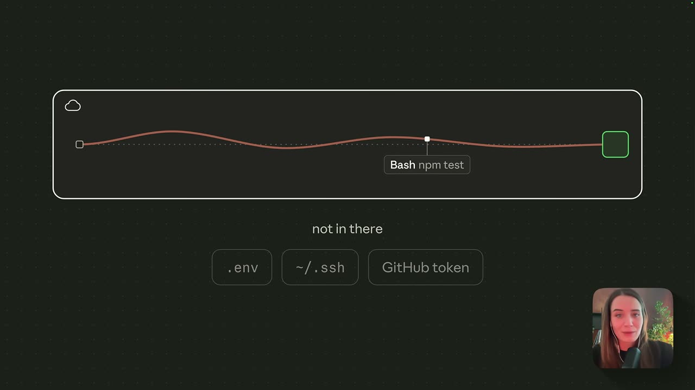
					- Not in there: `.env`, `~/.ssh`, GitHub token.
				- {{youtube-timestamp 583}} So in this case, this automatically gets rid of the `.env` file issue because it's not in Git, and neither are my SSH keys or our GitHub token.
				- {{youtube-timestamp 591}} **Slide 28**
					- 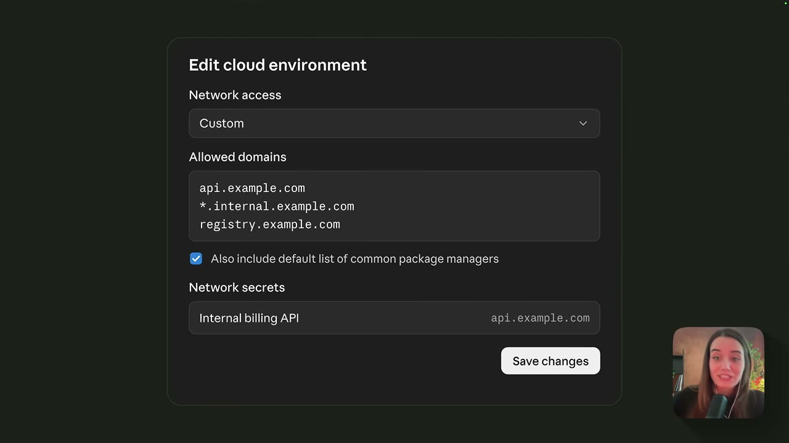
					- Edit cloud environment. Network access: Custom. Allowed domains: api.example.com, *.internal.example.com, registry.example.com. Also include default list of common package managers (checked). Network secrets: Internal billing API → api.example.com. Save changes.
				- {{youtube-timestamp 591}} And if it still needs an API key, you can add that as a network secret, where it will tell you, like, hey, I'm missing an API key mid-session, so it can use it without actually ever sending it to the model. And by default, also in the cloud session, network access is limited to things like package registries and GitHub. So you have to explicitly add those domains to your environment for Claude to reach other hosts.
				- {{youtube-timestamp 616}} Okay, so with a cloud session we can run these long-running sessions even with our laptop closed, and it keeps us safe because it runs in its own environment.
				- {{youtube-timestamp 625}} **Slide 29**
					- 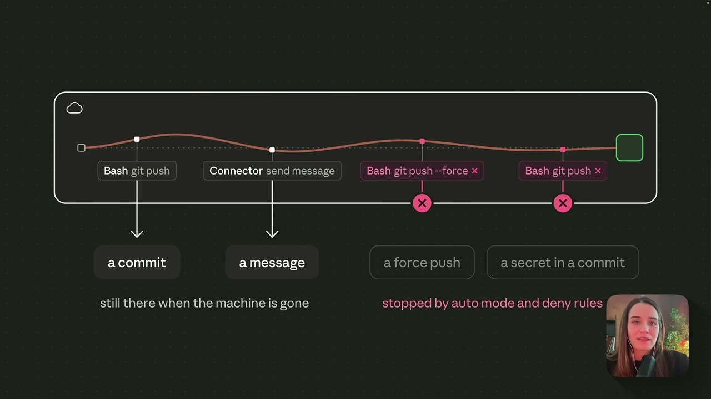
					- A cloud session runs Bash git push, Connector send message, Bash git push --force, Bash git push. A commit and a message are still there when the machine is gone. A force push and a secret in a commit are stopped by auto mode and deny rules.
				- {{youtube-timestamp 626}} Now it's still good to remember that this machine is disposable, but the things that leave it aren't. So a commit pushed or a message it sent through a connector. So we still run it in auto mode with our deny rules, just commit them into the repo so they come along. So it could still catch things like a forced push or a secret in a commit, all that kind of stuff.
			- ### {{youtube-timestamp 653}} Verification strategies
				- {{youtube-timestamp 647}} **Slide 30**
					- 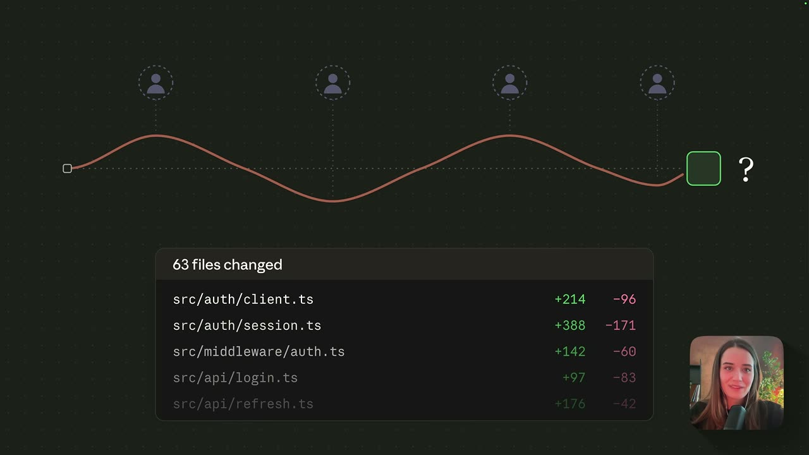
					- A long unattended run ends with a question mark: 63 files changed, including src/auth/client.ts (+214 −96), src/auth/session.ts (+388 −171), src/middleware/auth.ts (+142 −60), src/api/login.ts (+97 −83).
				- {{youtube-timestamp 647}} And beyond just safety, we also need to make sure that Claude is actually working on the right thing. So next is verification. And the nice thing about being in a loop, like, we kind of knew the work was good because we'd already kind of seen every change, we'd approved everything. But now if Claude works for hours in the background, we don't have that anymore. And we're not really going to read every file at the end either.
				- {{youtube-timestamp 672}} **Slide 31**
					- 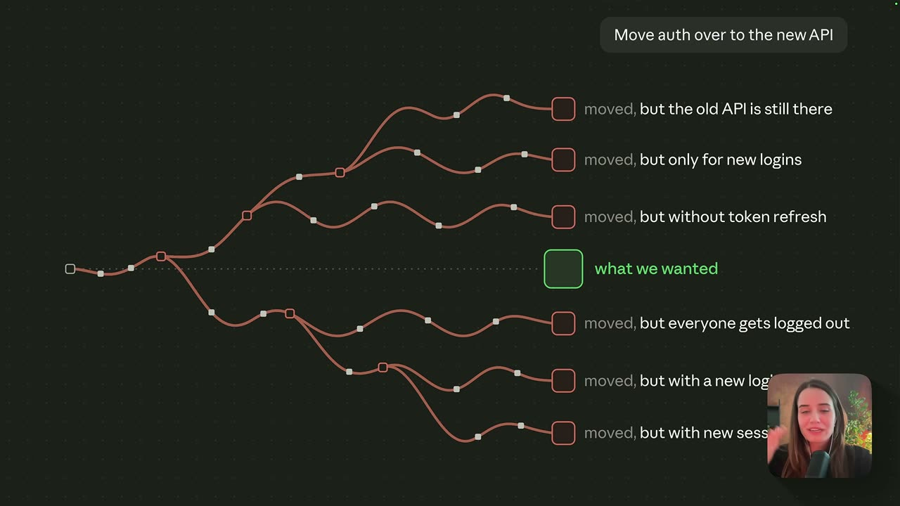
					- "Move auth over to the new API" branches into runs: moved, but the old API is still there; moved, but only for new logins; moved, but without token refresh; what we wanted; moved, but everyone gets logged out; moved, but with a new login; moved, but with new sessions.
				- {{youtube-timestamp 672}} So, you know, say that we ask it to move our auth to a new API. Well, Claude is very good at understanding what we want, but there are still a lot of small decisions that it has to make along the way. So with the exact same prompt, you know, one run might move it over but leave the old API in there, or one might move it but only for new logins, and another one might move it but log everyone out. And these all look pretty reasonable.
				- {{youtube-timestamp 696}} **Slide 32**
					- 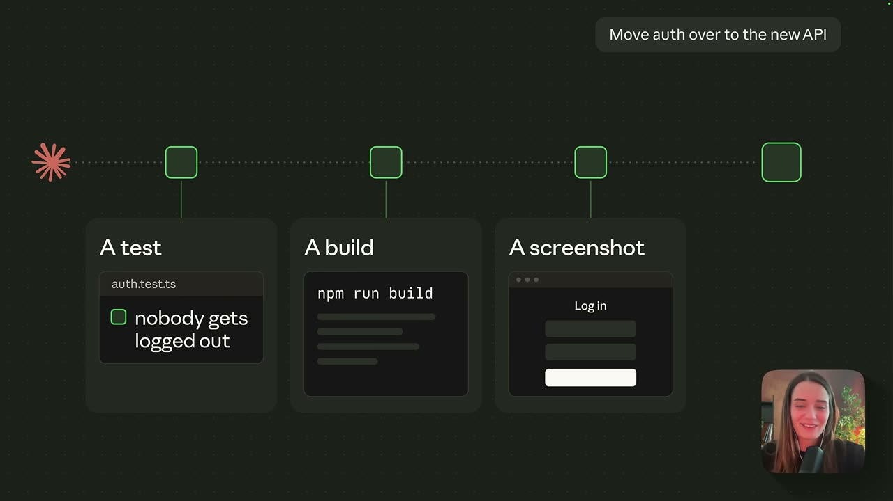
					- Verification points along the run: A test (auth.test.ts: nobody gets logged out), A build (`npm run build`), A screenshot (Log in).
				- {{youtube-timestamp 696}} But it really helps to set up these verification points along the way, so Claude keeps verifying its own results. And those can be anything that comes back as a pass or fail. So tests, a build, a screenshot, whatever you have. So now we just want to make sure that we review these verification points. They're a lot shorter to review than if we just had to, you know, review the whole change at the end. So that's pretty reasonable.
				- {{youtube-timestamp 719}} **Slide 33**
					- 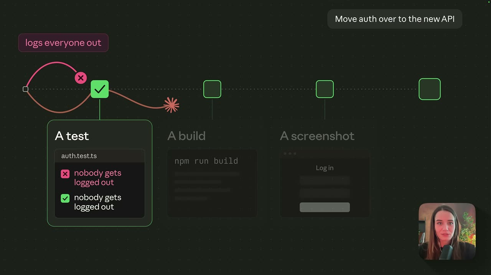
					- A run that "logs everyone out" fails the first test (nobody gets logged out) and loops back until the test passes.
				- {{youtube-timestamp 719}} So if one of these runs would still log everyone out, it doesn't get past that first check, and then it just has to find another way.
				- {{youtube-timestamp 726}} **Slide 34**
					- 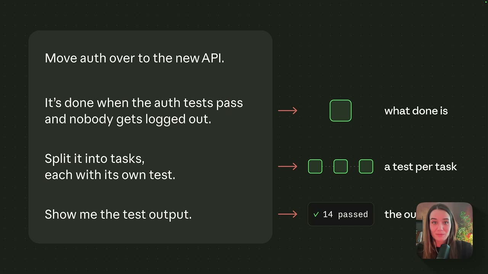
					- Prompt: "Move auth over to the new API. It's done when the auth tests pass and nobody gets logged out. Split it into tasks, each with its own test. Show me the test output." Mapped to: what done is; a test per task; the output (✓ 14 passed).
				- {{youtube-timestamp 727}} And there's a couple ways to set this up. The easiest one is, of course, just in your prompt. So, you know, you say what done looks like and ask it to split that into tasks so they have their own tests. And I also like to ask it to show the actual output, because you weren't there to see it.
				- {{youtube-timestamp 744}} **Slide 35**
					- 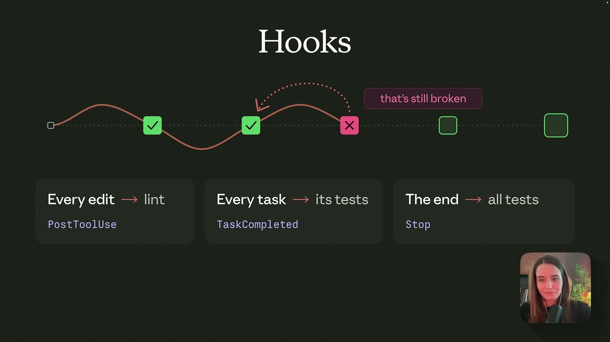
					- Hooks: Every edit → lint (`PostToolUse`). Every task → its tests (`TaskCompleted`). The end → all tests (`Stop`). A failed check: "that's still broken".
				- {{youtube-timestamp 741}} But again, prompting is not a guarantee that a model will do it. So for the ones that have to run, guaranteed run, I would use [[Claude/Code/Hook]]s, which are just, you know, scripts that Claude Code runs at a specific point. And those give you a lot of control, because you decide when they run and what they run and what they check. So for example, every time it edits a file, we can run our linter. Every time it wants to mark a task as complete, we can run the tests for what it changed. So, you know, if it touched our auth code or something, it has to pass the auth tests. And when it wants to finish the whole session, we can just run the entire test suite. And if one of those fails, it goes, oh, that's still broken. It goes back until it passes, so it fixes it.
				- {{youtube-timestamp 783}} **Slide 36**
					- 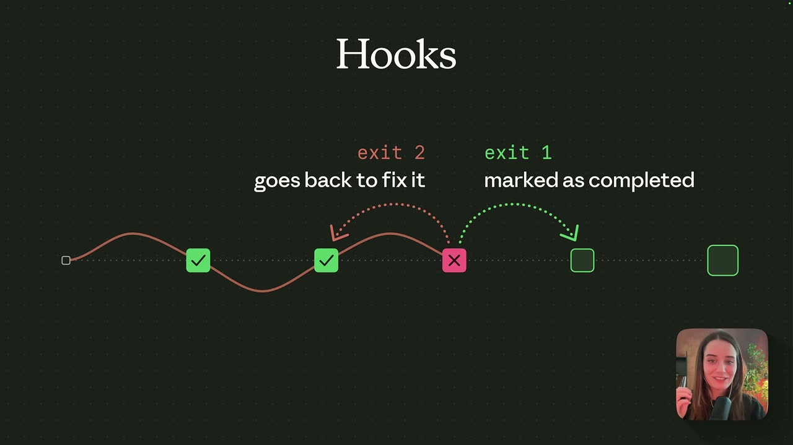
					- Hooks: exit 2 → goes back to fix it; exit 1 → marked as completed.
				- {{youtube-timestamp 784}} Now, just one thing: when a test fails, by default most tools exit with a 1 exit code. But with a 1, that task by Claude Code just gets marked as completed anyway. So make sure that your scripts exit with a 2 exit code, because that's what actually sends Claude back to fix it.
				- {{youtube-timestamp 811}} **Slide 37**
					- 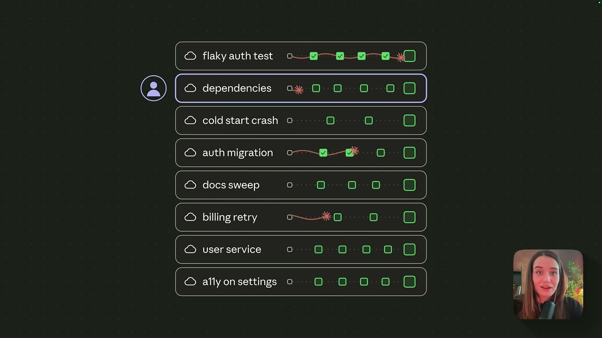
					- Eight cloud sessions side by side (flaky auth test, dependencies, cold start crash, auth migration, docs sweep, billing retry, user service, a11y on settings), each started by the person.
				- {{youtube-timestamp 802}} Okay, now we have one session that I'm pretty comfortable with leaving alone. So now we can start a few more of those, because they've all got their own machines, so they're, you know, not all working in the same folder, and we don't really have to think about [[git/worktree]]s too much ourselves anymore. But then we still start every session ourselves and we review every one of them. And honestly, this is already a pretty good place to be. We are still fully in control over what gets started and when we call a task done.
			- ### {{youtube-timestamp 840}} Scaling with CI and PRs
				- {{youtube-timestamp 833}} **Slide 38**
					- 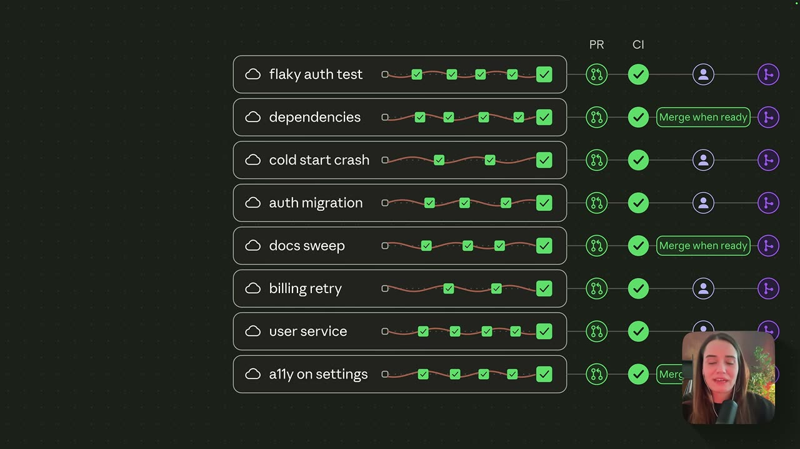
					- Each session's PR runs CI; dependencies, docs sweep and a11y on settings go to "Merge when ready", the rest to a person, then merged.
				- {{youtube-timestamp 833}} But even there, you know, we're still the ones kicking off every session and we're still in the loop for all of them. So I think the most important thing to have in place here now is your CI, because all of these sessions eventually open a PR, and your CI runs the same checks on every one of them, no matter how that session was set up or, you know, what Claude decided to do along the way. And if you turn on auto-fix, we have, like, CI auto-fix, Claude can also see when one of those checks fails and then go back to fix it. So you're not the one spending your review on things that, you know, a check could have already caught.
				- {{youtube-timestamp 867}} And for some of them, you can even turn on merge when ready. So then GitHub merges the PR once all of the checks have passed. So you're not in the loop to review. But again, that's not the default, and that really depends on how risky the change is.
				- {{youtube-timestamp 879}} **Slide 39**
					- 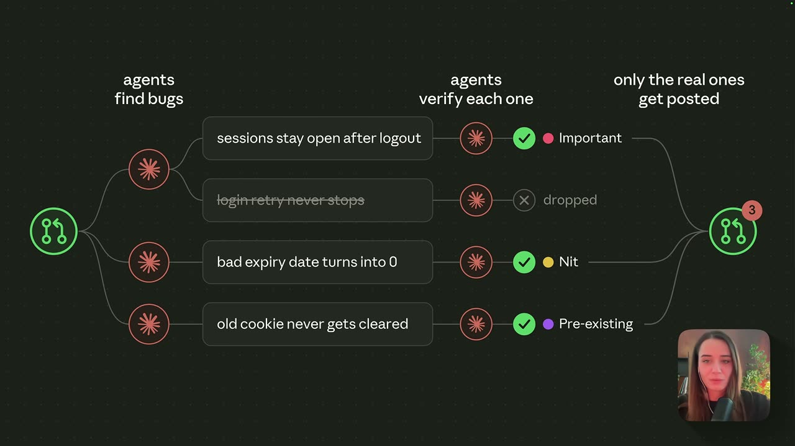
					- Agents find bugs (sessions stay open after logout; login retry never stops; bad expiry date turns into 0; old cookie never gets cleared); agents verify each one (login retry never stops is dropped); only the real ones get posted (Important, Nit, Pre-existing), three comments on the PR.
				- {{youtube-timestamp 879}} So for example, on our team, every PR gets reviewed by Claude first. So not by the session that wrote it. So it comes with a fresh context and also a separate group of agents to just double-check every bug it finds.
				- {{youtube-timestamp 893}} **Slide 40**
					- 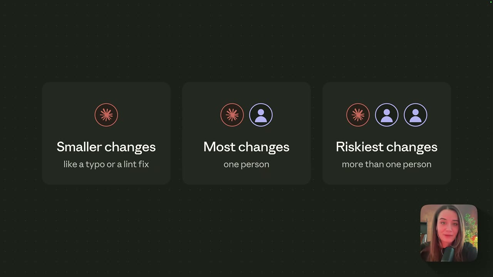
					- Smaller changes (like a typo or a lint fix): Claude only. Most changes: one person. Riskiest changes: more than one person.
				- {{youtube-timestamp 893}} And then how much we review ourselves just depends on the risk. So smaller changes, like docs or copy, they don't need a person. So once the automated checks are green, we're pretty good to go. Maybe ordinary product changes just need one reviewer, and then risky changes might need two.
			- ### {{youtube-timestamp 910}} Orchestration and conclusion
				- {{youtube-timestamp 909}} **Slide 41**
					- 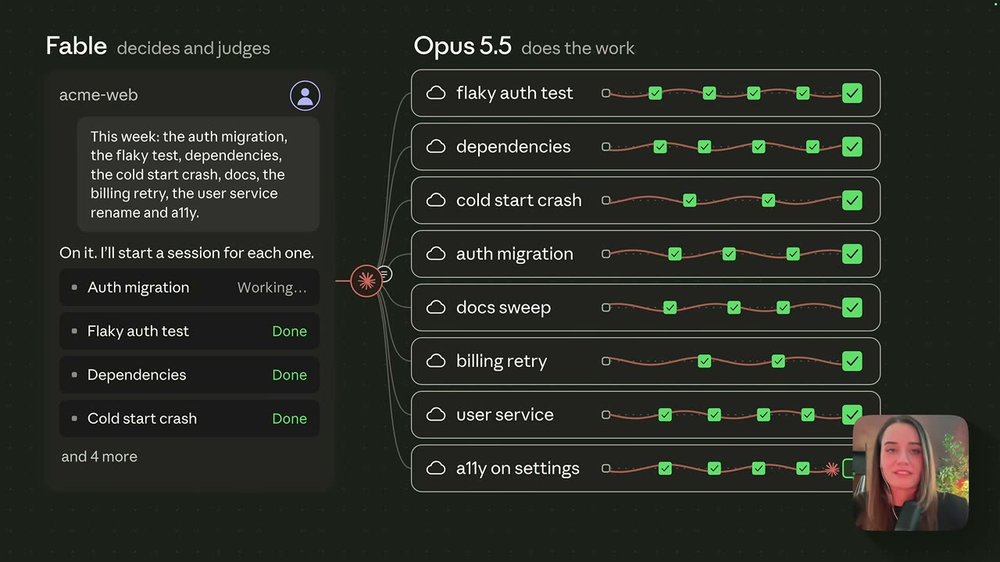
					- Fable decides and judges: the acme-web main session ("This week: the auth migration, the flaky test, dependencies, the cold start crash, docs, the billing retry, the user service rename and a11y." "On it. I'll start a session for each one.") tracks Auth migration (Working…), Flaky auth test, Dependencies, Cold start crash (Done) and 4 more. Opus 5.5 does the work in eight cloud threads.
				- {{youtube-timestamp 910}} Now, ultimately, kind of where we see things going, and we're already kind of doing more of that at Anthropic, is that you're not really starting all of those sessions yourself either. Because if you're anything like me, I'm terrible at context switching, so having to manage so many sessions at the same time doesn't always go well.
				- {{youtube-timestamp 927}} So instead, you just have one main session that's your orchestrator, and you can already see this in things like Claude Code projects, which is still in beta. But you just tell it what it needs to be done, and the orchestrator splits that up and then starts other sessions for each task, and it keeps track of what comes back. So it automatically starts and verifies these threads, which are just new sessions. So instead of talking to eight sessions, you're just talking to one.
				- {{youtube-timestamp 955}} And the main session doesn't write the code itself. So there you want a model that's really good at deciding what to do and judging what comes back, a model like Fable. And if something comes back that isn't actually done, it just, you know, sends it back until it's actually done and passes everything. And the threads need a model that's good at actually doing the work, like Opus 5.5. And you can set those separately. So, you know, one model for the main session and then another one for the threads.
				- {{youtube-timestamp 980}} And another benefit is that with this setup, with Claude Code projects specifically, we don't manage context anymore. That's all done automatically for us. [We] no longer have to think about, you know, when to compact or clear, all of that stuff.
				- {{youtube-timestamp 994}} **Slide 42**
					- 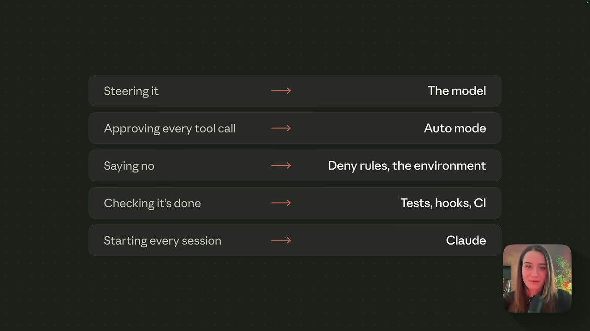
					- Steering it → The model. Approving every tool call → Auto mode. Saying no → Deny rules, the environment. Checking it's done → Tests, hooks, CI. Starting every session → Claude.
				- {{youtube-timestamp 994}} Okay, so if you look back at those old best practices, they're all still there, but they've just moved. So, the model steers it now, auto mode approves, your deny rules and the environment restrict what's possible, your tests, your hooks, and your CI check it. And then ultimately, Claude can just start them as well. So, almost everything we used to do ourselves is now either the model, the harness, or the environment. And we're really just here to start that first one and to just review what comes out.
				- {{youtube-timestamp 1022}} **Slide 43**
					- 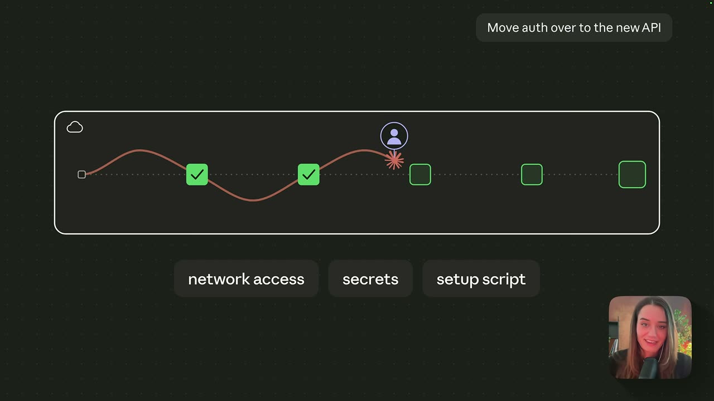
					- "Move auth over to the new API" in a cloud session, with three things to configure: network access, secrets, setup script.
				- {{youtube-timestamp 1022}} So, if you want to try this in your own setup, I would say just take one thing that's way bigger than you normally give Claude. Make sure your CI actually catches the things you care about, and then spend a bit of time just configuring your environment, like its network access, its secrets, and its, you know, setup script. And then start in the cloud and see where your sessions get stuck and where you're still in the loop, because that's the next thing to hand over to Claude.
				- {{youtube-timestamp 1046}} **Slide 44**
					- 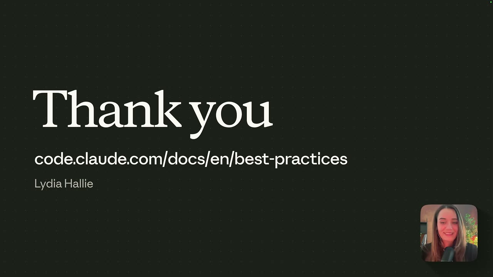
					- Thank you. [code.claude.com/docs/en/best-practices](https://code.claude.com/docs/en/best-practices). Lydia Hallie.
				- {{youtube-timestamp 1045}} I also highly recommend checking out our best practices in the docs as well. Thank you so much.
