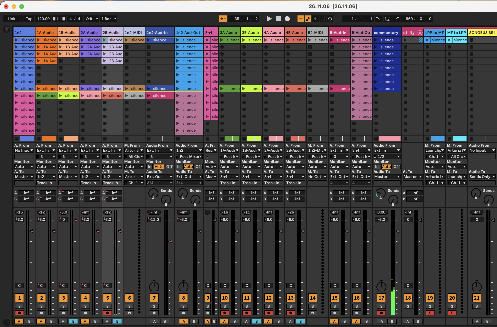

logseq-entity:: [[Logseq/Entity/Ableton/Set]]

- # 26.11.06
  live-version:: 11.3.43
  tempo:: 120
  time-signature:: 4/4
  source:: 26.11.06.als
	- 
		- The Session View mixer after the session, with the transport stopped at bar 35. Twenty-one tracks run left to right in the order of the embeds below; the two return tracks and the Main track sit off the right edge.
		- Most clip slots hold clips named "silence". The takes from the session sit on the four layers: three "1A-Aud" clips on 1A-Audio, two on 1B-Audio, two on 2A-Audio and three on 2B-Audio.
		- An orange box outlines the first eight tracks and eight scenes, the part of the grid the [[Novation/Launchpad/Pro/Mk3]] shows on its pads.
		- The crossfade buttons at the bottom light A on 1n2, 1A-Audio, 2A-Audio, 1n2-Aud-Out, 3n4, 3A-Audio, 4A-Audio, B-Aud-In and B-Aud-Out, and B on 1B-Audio, 2B-Audio, 3B-Audio and 4B-Audio. The MIDI tracks, 1n2-Aud-In, commentary and the utility group have neither.
		- Arm buttons are lit on 1n2, 2B-Audio, 3A-Audio, 3B-Audio, 4A-Audio, 4B-Audio, commentary, LPP to MF and MF to LPP.
		- Most volume fields read -6.0 dB with a red automation dot. 1B-Audio reads 0 dB, 1n2-Aud-In -12.0 dB, and utility and SONOBUS BRIDGE 0 dB. Pans on 1A-Audio through 2B-Audio also carry automation dots.
	- ## Signal path
		- The four layers record the [[Microfreak]] from external input 3. 1A-Audio, 2A-Audio and 2B-Audio send their audio to the 1n2 track; 1B-Audio goes straight to Main.
		- 1n2 sums its three layers and is assigned to the crossfader's A side. 2B-Audio passes through its own B assignment and then 1n2's A assignment, so the room hears it only with the crossfader near the middle. Only 1B-Audio reaches Main from the B side alone. [[Ableton/Live/UG/18 Mixing/05 Using Live's Crossfader]]
		- 3A-Audio, 3B-Audio, 4A-Audio and 4B-Audio take the outputs of 1A-Audio, 1B-Audio, 2A-Audio and 2B-Audio and feed 3n4, which also resamples Main. They hold only "silence" clips in this Set.
		- 1n2-Aud-In and 1n2-Aud-Out send input 3 and 1n2 to external outputs 3/4. B-Aud-In and B-Aud-Out send input 3 and 3n4 to external output 4.
		- LPP to MF carries the Launchpad Pro's channel 1 to the MicroFreak, and MF to LPP carries the MicroFreak back to the Launchpad's sequencer. 1n2-MIDI also sends to the MicroFreak, and B2-MIDI listens to 1n2-MIDI.
		- commentary takes inputs 1/2 to Main. A-Reverb holds a Reverb and B-Delay a Delay. 1B-Audio and 2B-Audio send to the reverb at -6 dB, 2B-Audio also sends to the delay at -6 dB, and 1A-Audio sends to the delay at -12 dB.
	- {{embed [[GitP/A/Session/26/11/06-Fri/Set/Track/1n2]]}}
	- {{embed [[GitP/A/Session/26/11/06-Fri/Set/Track/1A-Audio]]}}
	- {{embed [[GitP/A/Session/26/11/06-Fri/Set/Track/1B-Audio]]}}
	- {{embed [[GitP/A/Session/26/11/06-Fri/Set/Track/2A-Audio]]}}
	- {{embed [[GitP/A/Session/26/11/06-Fri/Set/Track/2B-Audio]]}}
	- {{embed [[GitP/A/Session/26/11/06-Fri/Set/Track/1n2-MIDI]]}}
	- {{embed [[GitP/A/Session/26/11/06-Fri/Set/Track/1n2-Aud-In]]}}
	- {{embed [[GitP/A/Session/26/11/06-Fri/Set/Track/1n2-Aud-Out]]}}
	- {{embed [[GitP/A/Session/26/11/06-Fri/Set/Track/3n4]]}}
	- {{embed [[GitP/A/Session/26/11/06-Fri/Set/Track/3A-Audio]]}}
	- {{embed [[GitP/A/Session/26/11/06-Fri/Set/Track/3B-Audio]]}}
	- {{embed [[GitP/A/Session/26/11/06-Fri/Set/Track/4A-Audio]]}}
	- {{embed [[GitP/A/Session/26/11/06-Fri/Set/Track/4B-Audio]]}}
	- {{embed [[GitP/A/Session/26/11/06-Fri/Set/Track/B2-MIDI]]}}
	- {{embed [[GitP/A/Session/26/11/06-Fri/Set/Track/B-Aud-In]]}}
	- {{embed [[GitP/A/Session/26/11/06-Fri/Set/Track/B-Aud-Out]]}}
	- {{embed [[GitP/A/Session/26/11/06-Fri/Set/Track/commentary]]}}
	- {{embed [[GitP/A/Session/26/11/06-Fri/Set/Track/utility]]}}
	- {{embed [[GitP/A/Session/26/11/06-Fri/Set/Track/A-Reverb]]}}
	- {{embed [[GitP/A/Session/26/11/06-Fri/Set/Track/B-Delay]]}}
