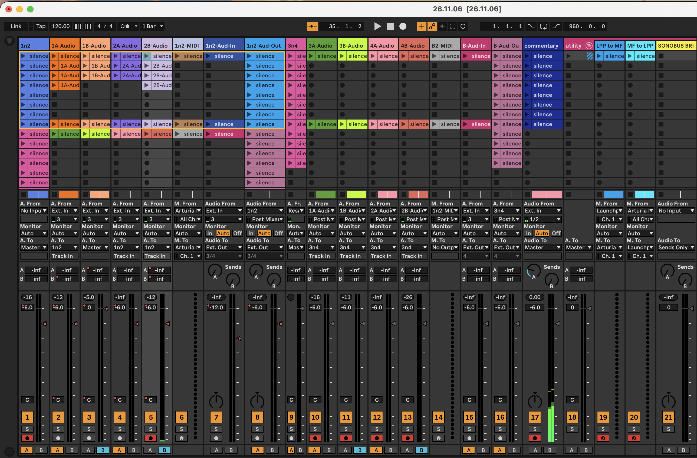

- [[2026-11-07 Sat]]
	- ## [[Ableton/Live/Log/26/11/07-Sat]]
		- decided to start a dedicated ableton live log for (re-)learning and looking back at the history to jog my memory.
	- ## [[GitP/A/Session/26/11/06-Fri]]
		- 
			- Here's an image of the set.
			- DONE [[Ghost Gardener]] please create [[Logseq/Entity/Ableton/Set]] using this and the xml. Move the image into [[GitP/A/Session/26/11/06-Fri/Set]] and rename it appropriately. Then fill it out to the best of your ability using the xml from ableton as well as the image. Describe the image contents in the set.
		- DONE please review these and their subnamespaces and then revise the words in [[GitP/A/Session/26/11/06-Fri]] and subpages to better adhere to my needs: [[GitP/Vibe]], [[My/AI/Rule]], [[My/Pref/Writing]].
			- [[AI/Response]] from [[Anthropic/Model/Claude/5/5/Opus]]
				- The first pass revised [[GitP/A/Session/26/11/06-Fri]] and skipped its asset subpages. That was a mistake: both carried the machine detail that [[GitP/Vibe/Anti]] lists under needless verbosity.
				- [[GitP/A/Session/26/11/06-Fri/Asset/Audio/Full/mp3]] dropped the bitrate, sample rate, bit depth, loudness and true peak. It now says what the file is: the whole 32-minute session, recorded in [[Ableton/Live]] on November 6, with the afterword at the end. The length stays in its duration-seconds property.
				- [[GitP/A/Session/26/11/06-Fri/Asset/MIDI/Session/mid]] took the H1 "Session MIDI" in place of "GitP.26.11.06 MIDI", and dropped "Type 1 standard MIDI file", "polyphonic aftertouch" and the MIDI channel. It now says what each track holds: the [[Novation/Launchpad/Pro/Mk3]] notes sent to the [[Microfreak]], and the key presses, key pressure and knob turns played on the MicroFreak itself.
				- [[GitP/A/Session/26/11/01-Sun/Asset/Audio/Full/mp3]] and [[GitP/A/Session/26/11/01-Sun/Asset/MIDI/Session/mid]] have the same wording and are unchanged. The gitp-asset-gathering skill doesn't contain that wording, so where it comes from is still unknown.
				- The track pages under [[GitP/A/Session/26/11/06-Fri/Set]] keep their properties as the ableton:set:import task wrote them, with values like AudioIn/External/M2, because running the task again rewrites those properties.
		-